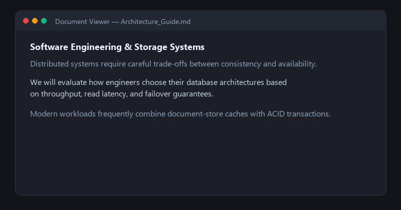

# 🗣️ SpeakThat
> Instant, offline text-to-speech for Windows: highlight any text and press `Ctrl+Shift+R` to hear it read aloud.

```powershell
irm https://raw.githubusercontent.com/amzmihon/Speak-That-Windows/main/install.ps1 | iex
```


[](https://amzmihon.com/Speak-That-Windows)
[](https://github.com/amzmihon/Speak-That-Windows)
[](https://github.com/amzmihon/Speak-That-Windows/releases)
[](https://amzmihon.com/Speak-That-Windows)
[](LICENSE)
[](https://github.com/amzmihon/Speak-That-Windows/actions)

🌐 **Official Website**: [https://amzmihon.com/Speak-That-Windows](https://amzmihon.com/Speak-That-Windows)  
🐙 **Source Code**: [https://github.com/amzmihon/Speak-That-Windows](https://github.com/amzmihon/Speak-That-Windows)  
🚀 **Latest Release**: [SpeakThat v1.2.0](https://github.com/amzmihon/Speak-That-Windows/releases/latest)

---

**SpeakThat** is a modern, ultra-fast Windows desktop Text Reader powered by **Paradee 8M ONNX TTS** (distilled from Kokoro-82M). 

Whenever you highlight any text across any Windows application (browser, PDF reader, Word document, IDE, chat app) and press **`Ctrl + Shift + R`**, SpeakThat instantly captures the selected text and reads it aloud with natural, high-fidelity human speech in under ~100ms.

Designed following the **Microsoft WinUI 3 Fluent Design System** ([microsoft-ui-xaml](https://github.com/microsoft/microsoft-ui-xaml)), SpeakThat features native Windows 11 DWM hardware rounded corners, semi-transparent frosted Acrylic backdrops, smooth floating pill capsules, and Segoe Fluent Icons.

---

## 📦 Download & Installation

SpeakThat is distributed as a completely standalone, offline Windows application. **No Python installation, command-line setup, or external dependencies are required.**

### 📥 Direct Release Downloads (v1.2.0)

| Package | Direct Download | File Size | Recommended For |
| :--- | :---: | :---: | :--- |
| **Windows GUI Installer** | [⬇️ **Download `SpeakThat-Setup.exe`**](https://github.com/amzmihon/Speak-That-Windows/releases/download/v1.2.0/SpeakThat-Setup.exe) | `114.8 MB` | **Most Users.** Automatic 1-click wizard. Installs to `%LOCALAPPDATA%\Programs\SpeakThat` and creates Start Menu and Desktop shortcuts. |
| **Portable Zero-Install Archive** | [⬇️ **Download `SpeakThat-v1.2-Windows-x64.zip`**](https://github.com/amzmihon/Speak-That-Windows/releases/download/v1.2.0/SpeakThat-v1.2-Windows-x64.zip) | `105.5 MB` | **USB / Portable.** Extract anywhere (e.g. `C:\SpeakThat` or flash drive) and launch directly. Includes `Install.bat`. |
| **Latest Release Hub** | [🏷️ **All Releases & Notes**](https://github.com/amzmihon/Speak-That-Windows/releases/latest) | — | View release notes, changelogs, and version history. |

---

### 🚀 Installation Options

#### Option 1: One-Command PowerShell Install (Fastest)
Open **PowerShell** (press `Win + X` and select **Terminal** or **PowerShell**) and paste:
```powershell
irm https://raw.githubusercontent.com/amzmihon/Speak-That-Windows/main/install.ps1 | iex
```
*This automatically downloads the latest `SpeakThat-Setup.exe` and launches the setup wizard.*

#### Option 2: Standalone Graphical Setup (`SpeakThat-Setup.exe`)
1. Download [**`SpeakThat-Setup.exe`**](https://github.com/amzmihon/Speak-That-Windows/releases/download/v1.2.0/SpeakThat-Setup.exe).
2. Double-click the downloaded `.exe` to launch the installer.
3. The wizard unpacks SpeakThat to `%LOCALAPPDATA%\Programs\SpeakThat` and automatically adds **SpeakThat** to your Windows Start Menu and Desktop.
4. SpeakThat starts automatically and docks in your Windows System Tray (near the clock).

> [!TIP]
> If Windows SmartScreen displays *"Windows protected your PC"* on first launch (common for newly published open-source binaries without an expensive EV code signing certificate), click **More info** → **Run anyway**.

#### Option 3: Portable Archive (`.zip`)
1. Download [**`SpeakThat-v1.2-Windows-x64.zip`**](https://github.com/amzmihon/Speak-That-Windows/releases/download/v1.2.0/SpeakThat-v1.2-Windows-x64.zip).
2. Right-click the `.zip` file and select **Extract All...** to any directory (e.g., `C:\SpeakThat` or a USB drive).
3. Open the extracted folder and double-click **`SpeakThat.exe`** to run immediately.
4. *(Optional)* Run **`Install.bat`** inside the folder if you want it to automatically create Start Menu and Desktop shortcuts for you.

#### Option 4: Run from Source (Python Developers)
If you prefer running from Python source code:
```powershell
git clone https://github.com/amzmihon/Speak-That-Windows.git
cd Speak-That-Windows
.\run.bat
```
`run.bat` automatically creates the `.venv` virtual environment, installs `requirements.txt`, and boots the app.

---

### 🖥️ System Requirements
- **OS**: Windows 10 (1809+) or Windows 11 (64-bit x64).
- **RAM**: 200 MB free memory.
- **CPU**: Standard x64 processor (Paradee runs on CPU with ~20x real-time speed, no GPU required).
- **Network**: **100% Offline** (the ONNX model is pre-bundled in the package).

---

## ⌨️ Global Shortcuts

| Shortcut | Action | Description |
| :---: | :--- | :--- |
| **`Ctrl + Shift + R`** | **Read Selection** | Instantly grabs highlighted text in any window and streams natural speech audio in ~100ms. |
| **`Ctrl + Shift + X`** | **Stop Playback** | Immediately stops / cancels speech playback and hides the floating HUD. |

*Note: You can customize both hotkeys via the live keypress recorder in the **Shortcuts & Behavior** tab.*

---

## 🎨 Floating Pop-up HUD Styles

SpeakThat allows you to customize the floating on-screen HUD widget:

| Style | Dimensions | Best For |
| :--- | :---: | :--- |
| **Default** | `440 × 74` | Full playback pill with live animated neural speech waves, status text, Pause, and Stop buttons. |
| **Small** | `310 × 54` | Compact pill capsule showing current status and essential controls. |
| **Tiny** | `154 × 46` | Minimal pill widget displaying only active waveforms and Stop button. |
| **No Pop-up** | `None` | Completely silent keyboard-only reading without any floating HUD on screen. |

---

## ✨ Key Highlights

- **WinUI 3 Fluent Design & Frosted Glass**:
  - Borderless, semi-transparent floating HUD capsule with smooth rounded pill corners.
  - Transparent color-keying eliminates rectangular box artifacts on Windows DWM.
  - Official Microsoft `Segoe Fluent Icons` / `Segoe MDL2 Assets` for native Pause (`\uE769`), Play (`\uE768`), and Stop (`\uE71A`).
  - Animated 3-bar sinusoidal neural waveform badge indicating real-time voice synthesis.
  - Windows 11 DWM hardware corner rounding (`DWMWCP_ROUND`) and GPU-accelerated Acrylic backdrop.

- **Paradee 8M TTS Engine**:
  - Ultra-compact ~8.5 MB int8 quantized ONNX model distilled from Kokoro-82M.
  - **18x to 25x real-time generation speed** on standard multi-core CPUs.
  - Generates crisp **24 kHz** audio waveforms.
  - Four distinct voice personas:
    - **`bf_isabella`** — Isabella (British Female, crisp & articulate)
    - **`af_heart`** — Heart (American Female, warm & expressive)
    - **`am_puck`** — Puck (American Male, casual & clear)
    - **`bm_fable`** — Fable (British Male, polished & narrative)

- **Zero-Latency Sentence Streaming**:
  - Splits text into natural sentence boundaries and begins audio playback on the very first sentence within **~100ms**, synthesizing subsequent sentences asynchronously in parallel.

- **Clipboard Preservation & Smart Fallback**:
  - Automatically snapshots and restores your existing clipboard history so reading selected text never overwrites your copied data.
  - Smart fallback reads clipboard content if no text is currently highlighted.

- **Studio Dashboard & System Tray**:
  - Two-column Fluent navigation rail (Studio Reader, Voice Personas, Shortcuts & Behavior, Model & Benchmark).
  - Lives quietly in the Windows notification area (System Tray) with right-click menu controls.
  - Adaptive resolution clamping with smooth `CTkScrollableFrame` fallback for small screens.

---

## 🔨 Building the Standalone Executable & Installer

To compile `SpeakThat.exe` and `SpeakThat-Setup.exe` from source:

```powershell
# 1. Activate your virtual environment
.\.venv\Scripts\activate

# 2. Run the release builder script
python build_release.py
```

The script will automatically:
1. Bundle all dependencies, assets, Misaki phonemizer dicts, Spacy models, and Paradee ONNX weights.
2. Compile `dist\SpeakThat\SpeakThat.exe` using PyInstaller.
3. Prune dead Cython C/C++ files and unused non-English dictionaries (saving >80 MB).
4. Generate `dist\SpeakThat\Install.bat` for one-click setup.
5. Package `dist\SpeakThat-v1.2-Windows-x64.zip` (portable distribution with max compression).
6. Compile the self-extracting GUI installer `dist\SpeakThat-Setup.exe`.

---

## 🛠️ Project Structure

```
Speak-That-Windows/
├── assets/                  # Application icons, HUD templates, preview images
├── brand/                   # Brand vector symbols, presentation kit, and palettes
├── speak_that/
│   ├── app.py               # Main application coordinator & lifecycle
│   ├── config.py            # User settings manager & config.json persistence
│   ├── engine.py            # Paradee TTS engine with sentence streaming
│   ├── hotkeys.py           # Global keyboard shortcut listener
│   ├── hud.py               # WinUI 3 Fluent floating pill HUD
│   ├── model/               # Quantized Paradee-8M ONNX weights & configs
│   ├── selection.py         # Windows selection grabber & clipboard manager
│   ├── tray.py              # System tray icon & context menu
│   └── ui.py                # Fluent Studio Reader dashboard window
├── .github/
│   ├── workflows/ci.yml     # Automated CI build & sanity check workflow
│   └── ISSUE_TEMPLATE/      # Bug report & feature request templates
├── build_release.py         # Automated release compiler & packager
├── installer_src.py         # Graphical setup installer builder
├── install.ps1              # One-command PowerShell installer script
├── main.py                  # Application entry point
├── run.bat                  # Developer launch script
├── CONTRIBUTING.md          # Development and contribution guide
├── LICENSE                  # MIT License
├── requirements.txt         # Dependencies
└── README.md                # Documentation
```

---

## ⚙️ Configuration (`config.json`)

Settings are automatically persisted to `config.json`:
```json
{
    "voice": "bf_isabella",
    "speed": 1.05,
    "volume": 1.0,
    "hotkey_read": "<ctrl>+<shift>+r",
    "hotkey_stop": "<ctrl>+<shift>+x",
    "restore_clipboard": true,
    "fallback_to_clipboard": true,
    "show_floating_hud": true,
    "hud_style": "default",
    "minimize_to_tray_on_close": true,
    "start_minimized": false,
    "window_width": 1000,
    "window_height": 620
}
```

---

## 🤝 Contributing

We welcome bug reports, UI enhancements, and new feature contributions! Please read our [**Contributing Guide**](CONTRIBUTING.md) to get started.

---

## 📄 License

This project is licensed under the **MIT License** — see the [LICENSE](LICENSE) file for details.

---

## 📜 Credits & References
- **Microsoft UI XAML**: [https://github.com/microsoft/microsoft-ui-xaml](https://github.com/microsoft/microsoft-ui-xaml)
- **Paradee TTS**: [https://github.com/sahilmahendrakar/paradee](https://github.com/sahilmahendrakar/paradee)
- **Model**: [https://huggingface.co/sahilmahendrakar/Paradee-8M-v1.2](https://huggingface.co/sahilmahendrakar/Paradee-8M-v1.2)
- **Base Architecture**: Kokoro-82M / Misaki G2P
